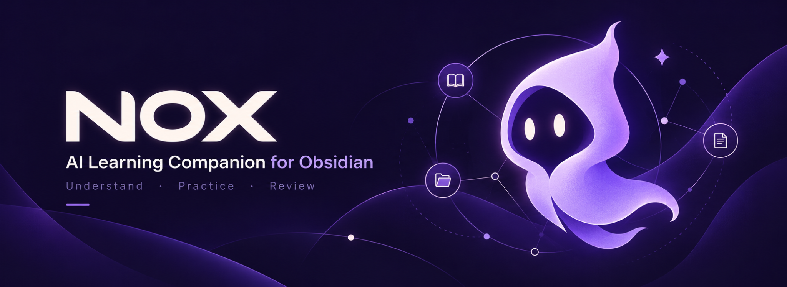

# Nox

**Turn your notes into understanding.**

Nox is an open-source AI learning companion for [Obsidian](https://obsidian.md) desktop. Explain ideas, practise with feedback, and follow a learning plan—all in your vault.

[Get started](docs/GETTING_STARTED.md) · [Providers & privacy](docs/PROVIDERS.md) · [Docs](docs/README.md) · [Report an issue](https://github.com/howlil/nox/issues)

 

## Features

- **Explain in context:** Learn from an open note, a selection, or an explicitly attached note.
- **Practice & review:** Interactive questions, coding answers, hints, and feedback. Coding answers are not executed or automatically verified.
- **Learning plans:** Build objective-based curricula, focus on one objective, and track progress through learning evidence.
- **Safe note edits:** Review proposed Markdown changes before applying them.
- **Choice of AI:** Use a configured AGY CLI, Codex CLI, or eligible ChatGPT plan.

## Install

Requires **Obsidian desktop 1.13.0+** and an external AI provider. Mobile is not supported.

- **Community Plugins:** If Nox is available in **Settings → Community plugins → Browse**, install and enable it there.
- **GitHub Release:** Otherwise, download \`main.js\`, \`manifest.json\`, and \`styles.css\` from a matching [release](https://github.com/howlil/nox/releases) into \`.obsidian/plugins/nox/\` in your vault, then enable Nox. Do not use GitHub's source ZIP.

## Start learning

1. Open a Markdown note, then open the **Nox** sidebar.
2. Choose **Learn from a note**, **Start with a goal**, or **Just chat** when first-run onboarding appears.
3. Connect your provider in **Settings → Nox**. Try **Explain** or **Practice** on a note.

To create a goal-based program from chat:

\`\`\`text
/plan Learn networking fundamentals | minutes=30 | sessions=3
/progress
\`\`\`

Use \`/focus <objective-id>\` and \`/next\` to begin the recommended activity. [First-session guide →](docs/GETTING_STARTED.md)

## Privacy

Your conversations and progress are stored locally. **Note content included in AI requests may be sent to the selected external provider.** AGY/Codex CLIs run with their own OS permissions and may access files or networks beyond Nox's note context. Proposed note edits require approval. Nox includes no model, credits, or provider subscription.

Read [provider permissions, credentials, and research scopes](docs/PROVIDERS.md) before using sensitive notes.

## Contribute

Requires Node.js 22 and pnpm 10. Run \`pnpm install --frozen-lockfile\` and \`pnpm verify\`, then see [Contributing](CONTRIBUTING.md). Changes are released through the [maintainer workflow](docs/RELEASING.md).

[MIT license](LICENSE) · [Changelog](CHANGELOG.md) · [Security](SECURITY.md)
