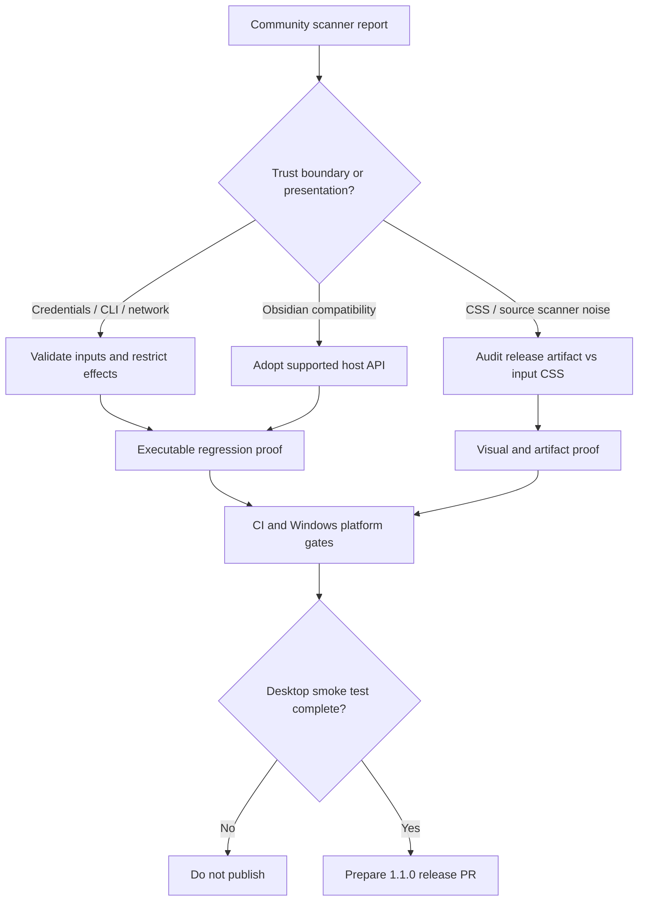

# NOX 1.1 — Obsidian Community Review Remediation

Status: implementation in progress; **not an acceptance or release certificate**.

## Problem / design-thinking framing

**User goal:** ship a trustworthy desktop learning plugin that passes Obsidian's automated review while retaining AGY, Codex, and ChatGPT plan integration.

**Constraints**
- The plugin requires Obsidian desktop 1.13.0+, uses provider CLIs and a Node HTTPS streaming transport, and persists OAuth tokens outside the vault by design.
- The public release contains exactly `main.js`, `manifest.json`, and `styles.css`; the production build uses Tailwind.
- NOX must not treat an arbitrary CLI as a sandboxed runtime; note mutations require explicit user approval.
- NOX settings are persisted through PluginDataRepository and runtime reconfiguration; bypassing this path risks corrupting sessions.

**Decision graph**

## Work packages and acceptance criteria

| Work package | Primary boundary | Proof |
| --- | --- | --- |
| Settings | `SettingsTab` → `PluginDataRepository` → runtime | Obsidian 1.13+ indexed definitions, persistence, reconnect, Usage/Token navigation |
| Credentials | disk bytes → `ChatGptAuth` | malformed credentials rejected without disclosure, encrypted Windows credentials and Unix owner-only permissions retained |
| CLI | configured binary → `AgyAdapter`/`CodexAdapter` | no shell-interpolated chat input; explicit argv, cancellation and bounded output |
| Network | `requestUrl` / Node HTTPS SSE → `ChatGptAdapter` | host allowlist, abort, incomplete streaming and no automatic POST replay |
| Vault | Obsidian API → context / proposal services | user-approved context, read bounds, explicit write confirmation |
| Lifecycle | Obsidian view/plugin unload → runtime | no unhandled rejection, timers/processes detached and time checkpoint observed |
| UI | render functions → CSS | no broad `:has` invalidation, fixed sidebar layouts, focus semantics |
| CSS build | Tailwind input → distributable CSS | compiled styles contain no Tailwind-only at-rules; scanner warnings verified against artifact |
| Release | merged commit → artifact, tag and directory submission | exact version match, 3 downloadable files, reproducible hashes, Windows test |

## Intentionally retained scanner recommendations

- **External filesystem**: ChatGPT OAuth credentials must not be stored in a synced Markdown vault; the OS-specific protection and path are documented in `docs/PROVIDERS.md`.
- **Child processes**: AGY and Codex are configured local binaries; using array-based `spawn` is a capability required for the desktop runtime, not shell command generation from model output.
- **Vault enumeration**: filename listing and opt-in research use the Obsidian Vault API; reads are bounded and scoped where available.
- **Clipboard**: copy actions are user initiated. No background clipboard reads are intended.
- **Session storage**: used only for transient dev hot-reload sidebar restoration, never as the plugin's durable data layer.
- **Node HTTPS streaming**: retained because Obsidian's `requestUrl` transport buffers SSE and cannot yield incremental events; OAuth continues to use `requestUrl`.

## Verification sequence

1. Check `pnpm install --frozen-lockfile`, `pnpm verify` and typecheck/lint.
2. Run agent protocol, storage, async lifecycle, quiz and CSS source-level regressions.
3. Confirm the Community scanner has **zero errors**. Review outstanding warnings individually rather than suppressing them.
4. Compare compiled `dist/styles.css` with scanner output. Avoid judging the Tailwind input file as if it were the final release asset.
5. Test install/enable/disable/reload, indexed settings, selected note and research, quiz submit/hint, proposal approval, and provider reconnection on Obsidian desktop 1.13.0+.
6. Test DPAPI sign-in roundtrip and cancellation on Windows; cover macOS/Linux private local token files where possible.
7. Prepare `1.1.0` only after the checks pass. The exact GitHub tag is `1.1.0`, not `v1.1.0`.

**Release policy:** Do not merge/publish a release solely because lint output is shorter. Existing Node process and credential capabilities remain subject to documented security review and end-to-end behavior proof.
