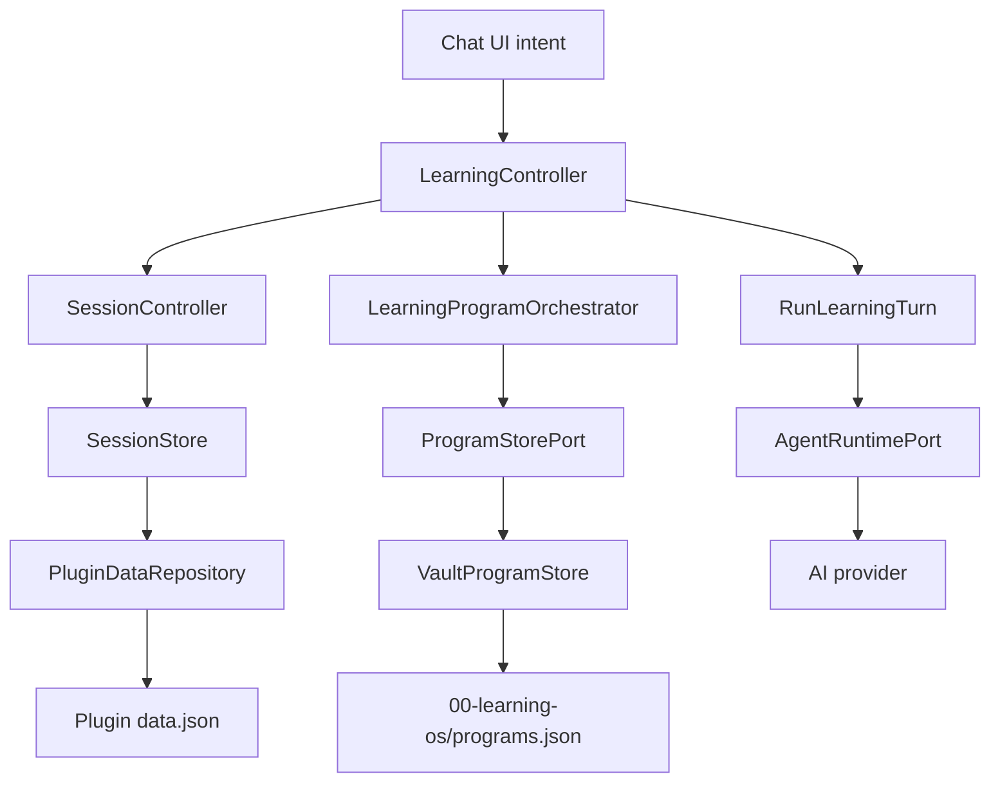

# NOX program JSON recovery and chat-history failure isolation

Status: architecture audit and staged implementation plan (2026-10-15). This document is not evidence of a successful real-vault repair.

## Problem and evidence

User observation: after deleting all chat history, ordinary questions and `/plan` exhibit immediate failed turns. An error notice says `Invalid NOX programs JSON.`.

Source trace:

1. `ChatView -> LearningController.run -> runTimedTurn -> LearningProgramOrchestrator.beginAiWait`.
2. `beginAiWait -> getActiveProgram -> VaultProgramStore.load -> JSON.parse`.
3. Parsing `00-learning-os/programs.json` fails before provider execution.
4. `main.ts` logs but does not surface `recoverSessions()` startup failures.
5. `SessionController.mutateHistory -> SessionStore.deleteSessions/ensureActiveSession` is a **separate** plugin-data write. No direct deletion of `programs.json` was found.

Therefore, the screenshot establishes a program-file parsing failure and a cross-boundary failure cascade, **not** that history deletion corrupted the file. File bytes, Obsidian events, plugin build revision, and vault logs are still needed to attribute the corruption itself.

## Responsibility graph

- Domain transitions belong to the learning program domain rules.
- Program data validation/serialization and reliable Obsidian reads belong to `VaultProgramStore`.
- Scheduling, read-modify-write sequencing, and time accounting belong to `LearningProgramOrchestrator`.
- Deciding whether a program-store failure blocks a given user intent belongs to `LearningController`.
- Conversation delete/archive/fallback belongs to `SessionStore`; transaction commit belongs to `SessionController`.
- Error visibility, bounded retries, and recovery actions belong to `ChatView`.

Do **not** add a second session repository, general-purpose file-recovery framework, or cross-domain 'global state manager'.

## Design thinking

**Understand:** A learner should not lose ordinary chat because an independent curriculum file is malformed, and should not lose learning evidence through an automatic reset.

**Define:** Guarantee graceful degradation, fail-closed on progress-changing learning commands, preserve original bytes, and make recovery verifiable.

**Ideate:** (1) overwrite malformed file with defaults (rejected: destructive); (2) catch all exceptions and proceed (rejected: hides corruption/time accounting); (3) classify program-data failures at the existing ports and degrade only independent operations (selected).

**Prototype:** Add a dedicated recovery status in the existing chat/learning menu; preserve all source files, offer "Back up file" / "Open program file", never an auto-delete action. The ordinary composer remains usable. One concise error per failed command, with collapsed historical failures.

**Test:** Reproduce the exact state-transition sequences below with fault injection and then in a disposable Obsidian desktop vault. Ensure tests use real persistence adapters at the integration boundary, not only mocked controller outcomes.

## Current patch scope

- Await in-flight `VaultProgramStore` writes before reads; use the fresh vault read for state that will be mutated.
- Report malformed program JSON with the affected relative path and non-destructive recovery guidance.
- Allow non-program turns to continue when time-accounting preflight cannot read the program file; fail closed on curriculum-linked or ordinary program Practice operations.
- Add regression tests for the preflight failure and store freshness/ordering.

These changes **do not** reconstruct corrupt data or guarantee that the storage file was valid on the user's machine. They also do not finish user-visible recovery UX, durability instrumentation, or cross-device conflict detection.

## Next milestones

### P0 — Confirm actual vault corruption and non-destructive recovery

- Back up `00-learning-os/programs.json` and `00-learning-os/progress.json`.
- Collect redacted JSON validator result, byte count, first/last bytes, timestamp, plugin build revision, and stack trace; do not publish curriculum content or credentials.
- Compare fresh `vault.read` with on-disk file bytes and look for truncated content, conflict copies, or concurrent writer interference.
- User explicitly chooses restore from a known-good backup or rename damaged file. Do not replace a bad file with an empty collection automatically.
- Verify restored curriculum and evidence refer to consistent objective IDs.

### P1 — Durable program persistence

- Use Obsidian `Vault.process` for read-modify-write **when an existing file is updated**, validating the prior JSON and checking that the snapshot used to derive the change still matches the current content.
- No I/O inside the process callback; optimistic conflict must be handled by explicit retry or user resolution, not last-writer-wins.
- Coordinate writes from `createProgram`, checkpoints, startup recovery, plan selection, and session start/finish through one application ordering boundary.
- Write and validate a last-known-good copy only after a successful commit. Consider Obsidian sync behavior and file watcher ordering.
- Never treat a failed write as a committed learning event.

### P1 — Error recovery UI

- Surface `learning-program-unavailable` once per failed file version, not as 10 repeated thinking traces.
- Distinguish missing, unreadable, parse-invalid, schema-invalid, unsupported-version, and write-conflict states.
- Keep chat and history accessible. Disable only program-required actions with specific next steps.
- Preserve failed prompt for retry; do not automatically re-run expensive model inference.
- Show storage path, backup action, and retry after the file is repaired; avoid toasts on the 2s clock polling path.

### P2 — State-transition and observability hardening

- Add telemetry counters (without content): `program_load_failed`, `program_write_conflict`, `history_mutation_failed`, `turn_preflight_failed`.
- Debounce repeated root-cause notifications and aggregate retry attempts.
- Include `turnId`, `sessionId`, `operationId`, store kind, phase, and elapsed milliseconds in local diagnostic logs; omit prompts/learning data.
- Prove that archiving/deleting history does not change program bytes or evidence bytes.

## Workflow coverage matrix

| Scenario | Current evidence | Desired assertion / next test |
|---|---|---|
| Delete all active chats | Covered: `tests/session/HistoryActions.test.ts` | Fresh selectable thread; no old messages |
| Archive all active chats | Covered: same suite | Archived transcripts retained; fresh active fallback |
| Failed bulk history write | Covered: same suite | No partial publication or lost transcripts |
| Damaged legacy session migration | Covered: `tests/session/SessionController.test.ts` | Keep undecodable source |
| Missing programs.json | Store behavior; new unit test | Empty collection, normal chat usable |
| Malformed programs.json | New unit test | Existing bytes untouched; program actions blocked |
| Stale cached program read | New unit test | Fresh disk read, no stale overwrite |
| Read concurrent with program save | New unit test | Load waits for pending local write |
| Invalid program + unrelated chat | New controller test | AI provider still invoked |
| Invalid program + Practice | New controller test | No AI provider call |
| Invalid program + delete all + new chat | NOT COVERED end-to-end | Normal chat restored; no cross-domain write |
| Truncated JSON after interrupted update | NOT COVERED | Recoverable backup, no overwrite |
| Valid JSON with invalid domain shape | NOT COVERED | Diagnostic, no mutation |
| Unknown future schema version | NOT COVERED | Explicit upgrade needed, no destructive downgrade |
| Simultaneous save from another plugin/device | NOT COVERED | Detect conflict; no silent last-writer-wins |
| Obsidian sync conflict copy | NOT COVERED | Preserve both and offer resolution |
| Program file deleted while app running | NOT COVERED | Safe fallback, no artificial mastery reset |
| Permission denied / disk full | PARTIAL | No false success, original remains intact |
| Cancel/timeout during program generation | Some program tests | No partial curriculum, idempotent retry |
| Active timed session + corrupt file | NOT COVERED | Warn timing unavailable; no invented active time |
| Provider unavailable + history restored | PARTIAL | History remains readable and retryable |
| 10 repeated failures | NOT COVERED | One recoverable diagnostic; bounded retries |
| Two windows / concurrent program operations | NOT COVERED | Deterministic ordering or explicit conflict |
| Program repaired while UI is open | NOT COVERED | Revalidate then unblock without restart |

## Exit criteria

1. A corrupted program file cannot prevent ordinary chat or history operations.
2. Program-specific commands fail with a relevant explanation and never write fabricated progress.
3. History deletion/archive never modifies `programs.json` or `progress.json`.
4. No damaged program file is auto-overwritten or silently discarded.
5. `pnpm verify` passes and disposable real-vault tests cover bad JSON, delete-all, retries, and restart.
6. A failed recovery path leaves original bytes recoverable.
7. The in-app recovery UI offers a single actionable error, with no infinite toast loop.

Reference: https://docs.obsidian.md/Plugins/Vault — use `Vault.process` when reading-and-modifying file content and `Vault.read` rather than `cachedRead` for fresher mutable state.
