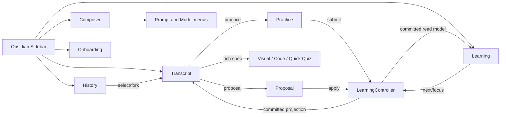

# NOX UI atomicity — source-grounded contract (M0–M5)

**Branch:** `refactor/ui-atomicity-m0-m5`, stacked on `refactor/ui-feature-ownership` (PR #129). **Not a replacement for native Obsidian acceptance.** Release 1.3.2 and manifest changes are separate.

## Product contract and non-goals

Nox is an Obsidian sidebar AI learning assistant with one native Settings screen. Preserve the current learning/assessment, conversation, vault-context, model/auth, analytics and edit-approval behavior.

- No new UI framework, runtime/adapters, global app state store, second repository, or changed persisted schema.
- No automatic UI merge or release without proof of actual native Obsidian acceptance.
- A named `Surface` owns user-visible content, meaningful state and actions; a `Unit` owns a reusable behavior with a stable contract. Do not create one file per visual atom.
- Each surface exposes all required interactive moves with keyboard and focus reachability, reduced-motion support where animation exists, and recovery after expected failures.
- Native Practice carries durable graded evidence. Response Quick Quiz is **local and untracked**. Shared code editor does not own learning data.

## M0 — UI component registry: Surface<C,V,N> + owners

| Surface | C (content/actions) | V (rendered variants) | N (prerequisites) | UI owner (PR #129) | Durable owner / effects |
|---|---|---|---|---|---|
| Shell/header | open, new chat, history, learning navigation | ready, unavailable, empty, error | Obsidian leaf | `ChatView` | `LearningController` |
| Composer | prompt, send/cancel, attach, context, reply quote, action | empty, dirty, running, locked, runtime-offline | active session, provider or offline command | `NoxComposer` + shell wiring | `SessionController` via application |
| Prompt menu | slash actions, `@note` search, programs | filtered, empty, source/command, pending, closed | open composer, relevant context | `PromptMenuPresenter` | injected command callbacks |
| Model menu | discover and select model, retry | loading, error, selected, open/closed | runtime catalog and session | `ModelMenuPresenter` | `LearningController.setModel` |
| History | select, fork, archive, delete, restore; swipe | empty, active/archived, selected, confirmation, error | session snapshots | `HistoryPresenter` / `NoxHistoryList` | `SessionController` |
| Transcript | user/assistant messages, regenerate, versions, actions | empty, restoring, streaming, cancelled, failed | session ID + messages | `TranscriptPresenter`, response actions, shell bubble wiring | `SessionController` |
| Thinking | observed phases, tools, timer, disclosure, restore | running, waiting, failed/stopped/done, collapsed/expanded | observed runtime events | `ThinkingPresenter` | event source/transcript |
| Native Practice | MCQ/essay/code draft, hint, submit, evaluation | dirty, saving, assisted, failed, evaluated | committed question and matching session ID | `PracticePresenter` + `PracticeCards` | `SessionController` + evidence |
| Quick Quiz | response-generated one-by-one questions | idle, editing, completed | validated response quiz spec | `response-quiz-render` | local only — not mastery |
| Learning map | objectives, dependencies, gaps, next command | empty, selected, active, revision | committed program read model | `LearningPresenter` + graph render | program/evidence stores |
| Activity | heatmap, filters, materials | empty, populated, pending | program history | `LearningPresenter` + heatmap render | program store |
| Focus/timer | focus, pause/resume, time and progress | hidden, active, paused, interrupted, recovered | active program | `LearningPresenter` | program store |
| Onboarding | source, goal, preview, approve, resume/recover | welcome, form, generating, preview, applying, retry, ready | first-run context, provider as needed | `OnboardingFlow` | workflow/approval repositories |
| Proposal/review | diff, apply/reject, status, retry, finding | pending, applied, rejected, stale, failure | persisted edit and source freshness | **currently shell-owned proposal UI** | `LearningController.applyProposal` |
| Rich output | tables, cards, charts, diagrams, graphs, HTML preview | loading, invalid fallback, expanded, resize | validated model payload | `response-visuals` + renderer units | transcript |
| Settings | provider, model, account, usage, token | connected, saving, loading, stale, error | Obsidian settings tab | `SettingsTab` / section mounts | settings and token repository |
| Shared controls | button, icon, chip, menu row, surface, status, popover | active/disabled/open | parent surface | `primitives.ts`, `menu.ts`, `popover.ts` | **none** |

### Move and attention graph



- Menus/dialogs own intentional focus and Escape; toast/status cannot steal focus.
- Switching session invalidates async projection and prevents stale updates; draft saves must finish or fail visibly.
- Native host `ChatView` alone owns leaf mount/unmount; nested DOM presenters own their timers/listeners.
- Responsive pane/theming projects the same capabilities under smaller width; visual topology need not remain identical.

### UI atoms vs compositions

```text
Shared primitives (stable contract, no domain)
  → Icon, Button, Chip, Status, MenuRow, Popover, Surface
Composite reusable units (stable lifecycle or multi-surface reuse)
  → CodeAnswerEditor, GraphViewport, PreviewFrame, AsyncStatus
Feature surfaces (own meaningful user moves/state)
  → Composer, History, Transcript, Practice, Learning, Onboarding,
    Proposal, Model/Prompt Menu, Thinking, Settings
Obsidian host (cross-surface routing, no feature rendering)
  → ChatView / SettingsTab
```

## M1 — Integration contract for PR #129

**A:** Use the existing tested UI presenter architecture on this branch as source; do not duplicate models/menus/timers.
**E:** Master may advance while the parent refactor remains Draft; the source of a released build can diverge.
**R:** GitHub CI and native desktop verification.
**Gate:** Inherit PR #129; do not merge into `master` while its D01–D10 native Obsidian acceptance is still NOT RUN. Keep the stacked PR base pointed at `refactor/ui-feature-ownership`.

## M2 — Empty/Onboarding and Proposal isolation

- Isolate meaningful UI rendering and callbacks from `ChatView` behind narrow DOM/presentation functions or presenter ports.
- Preserve `OnboardingFlow` as the single approval/recovery owner; **do not** copy `requestEpoch`, `operationId`, or `approve()` to another store.
- Proposal UI reads committed proposal statuses through existing `LearningController`; no provisional success.
- Scope proof: change a proposal/empty-state rendering test without modifying adapter, session, or learning repositories.
- Expected failures: stale proposal, lost note identity, failed vault mutation, disconnected provider. Recovery must remain on the affected surface.

## M3 — Composer ownership

- Owner of ephemeral composer state: text input DOM, local attachment queue, context chips, reply quote, active action. Their synchronization flows through one composer-facing port.
- Only the application may authorize/send; UI is not a security boundary.
- Explicit `IDLE → DIRTY → ADMITTING → RUNNING → (ANSWER | ERROR)` where consequential; preserve draft and single-flight admission.
- Keep multi-step changes local (context changes invalidate projection; reply quote never leaks to another session).
- Model/Prompt presenters remain the unique menu owners.

## M4 — CSS surface boundaries

- Split authored CSS into low-depth `styles/` sources: tokens/foundation, shell, composer, conversation, practice, learning, onboarding, visuals, settings.
- `styles.css` remains the **single shipped output** required by Obsidian. The existing Tailwind/PostCSS build is the composition authority.
- No regressions in no-gradient flat styling, shared NOX variables, source order, host theme scoping, widths, or official Community CSS policy.
- Test source concatenation/order and CSS artifact checks. Avoid rewriting selectors mechanically.

## M5 — Interaction contracts / release safety

- Tests: keyboard focus and Escape, async stale results, identity across session switch/fork, Practice draft write order/failure, approval idempotency, proposal pending/stale, memory/resource cleanup.
- Gate: `pnpm check:boundaries`, `pnpm architecture:graph`, `pnpm typecheck`, `pnpm lint`, `pnpm test`, CSS build, artifact and Community scanner.
- Native acceptance D01–D10 remains explicitly **NOT RUN** until actual evidence for the exact candidate commit exists.

## Design-thinking: execution graph A/E/R, boundaries, scope and review

```text
A / user move
  → surface local state (without durable side effect)
  → injected callback into ChatView/application
  → trusted decode/authorization by existing domain and controller
  → serialized durable commit by SessionController / program / workspace store
  → fresh read model
  → present committed state
E / expected failure
  → scoped status, preserve user input, explicit retry or recovery
Defect
  → surfaced through existing runtime error/reporting; no silent success
Interruption / view close
  → cancel run, invalidate epochs, detach listeners/timers
R / capabilities
  → DOM mount, host callbacks, read models, explicit commands; no repositories in presenters
```

Ordering invariants: pending Practice draft saves precede navigation/turn admission; proposal success UI follows committed mutation; onboarding approval uses one operation ID; terminal Thinking settles once and stops timers; no stale response can write to a new leaf.

## Code review protocol per milestone

1. Inspect actual branch diff and reconstruct the success path.
2. Check **Major**: duplicate durable authority, lost draft, unsafe mutation, stale callbacks, unhandled lifecycle.
3. Check **Minor**: focus/ARIA, empty/loading/error variants, orphan listeners and inconsistent CSS source.
4. Add targeted regression tests and run branch CI before starting next milestone.
5. Record actual CI and unresolved native gate honestly, not as fabricated PASS.

## Implementation record — PR #132, M0–M5

| Milestone | Code changes | Targeted proof | Code review result / residual |
|---|---|---|---|
| M0 | This registry defines all known main sidebar/settings surfaces, C/V/N and state ownership. | Source checked against `src/chat`, feature view modules, SettingsTab and canonical persistence owners. | No new product workflow or repository. |
| M1 | Existing PR #129 presenters reused; no new parallel History/Practice/Thinking implementation. | Architectural owners remain unique in source. | **External gate:** PR #129 Draft; native Obsidian D01–D10 remains NOT RUN. |
| M2 | `ProposalPresenter` extracts proposal diff/status/actions/restoration; `empty-slate-renderer` extracts primary action and current-note projection; `OnboardingLearningPort` narrows flow dependency. | `proposal-presenter.test.ts`, `ui-atomicity.test.ts`. | Fixed stale async updates to detached proposal and empty slate. Approval remains authoritative in existing OnboardingFlow/LearningController. |
| M3 | `ComposerAttachmentDraft` owns explicit context references; removed mirrored `attachments` / `extraCtx` state. Input file batches stage all files before commit; stale session reads are dropped. | `composer-draft.test.ts`, architecture guard, CI. | Fixed context alias mutation, late file reads and partial attachments after file read failure. No global state store. |
| M4 | `styles.css` is an import-only entry for 14 ordered source CSS files, still built as one `dist/styles.css`. CSS parser now checks `styles/*.css`; design tests concatenate imported source in original cascade order. | `ui-css-source-order.test.ts`, branding/keyboard/code editor CSS tests, production build/artifacts. | Source split was lossless at extraction; host computed styles still require native desktop proof. |
| M5 | Added actual interaction tests for Proposal async completion/disposal, Composer state projection, CSS contracts and UI owner boundary. Parent PR #129 tests still cover model/quiz/thinking. | `pnpm verify`, GitHub Actions, Community policy and build checks. | **Host D01–D10 NOT RUN**. This branch must not be shipped on CI alone. |

## CSS ownership map

The numbered source order is deliberate: maintaining the historical cascade is safer than regrouping selectors and silently changing specificity precedence. Use the appropriate owner file and preserve ordering until native visual regression tests exist.

| Source CSS | Primary concern |
|---|---|
| `styles/01-foundation.css` | Shared tokens/base/sidebar, early retained rules |
| `styles/02-composer.css` | Inline context composer |
| `styles/03-history.css` | History baseline |
| `styles/04-practice.css` | Native quiz and coding editor |
| `styles/05-settings-usage.css` | Usage analytics and provider quotas |
| `styles/06-practice-feedback.css` | Hint/evaluation |
| `styles/07-visuals.css` | Diagrams, graph viewport, response cards, isolated previews |
| `styles/08-thinking.css` | Agent observed activity |
| `styles/09-settings-shell.css` | Settings shell and hosted dialogs |
| `styles/10-history-interaction.css` | Swipe/focus/interaction and later overrides |
| `styles/11-onboarding.css` | Onboarding cards/forms |
| `styles/12-activity.css` | Learning activity |
| `styles/13-settings-navigation.css` | Settings segmented navigation and later overrides |
| `styles/14-learning.css` | Evidence-backed learning UI |

**CSS caution:** this is an order-preserving *authoring split*, not a declaration that selector responsibility is perfectly atomic yet. Rules from historical CSS may still overlap; do not reorder modules or change broad selectors without computed-style native proof.

## State ownership and resource lifetime verification

```text
Composer attachment read (async)
  -> captured session ID + leaf epoch
  -> stage all file text before local commit
  -> failure: no partial mutation, report error, allow user retry
  -> success: ComposerAttachmentDraft.add
  -> contexts(): cloned explicit source refs
  -> LearningController receives snapshot at send
  -> draft owner clears only when turn is admitted

Proposal apply/reject
  -> ProposalPresenter local disable/pending
  -> injected port -> LearningController -> committed mutation
  -> if old UI detached: ignore post-await DOM/status
  -> if still connected: show authoritative outcome
  -> status-sync uncertain: retry status only, NOT apply again

Empty state action / onboarding
  -> stateless renderer + authorized shell callback
  -> OnboardingFlow remains sole stage/request-epoch/operation-ID owner
  -> OnboardingLearningPort narrows accessible application operations
  -> no new program/vault data store

CSS
  -> source imports preserving original order
  -> Tailwind entry styles.css
  -> one dist/styles.css
  -> plugin release only includes required Obsidian bundle assets
```

## Merge / release rule

**Do not merge or publish merely because typecheck/build is green.** Parent PR #129 is Draft and requires real D01–D10 Obsidian Desktop acceptance on the actual source SHA. This stacked PR is intended to target `refactor/ui-feature-ownership` after automated verification; GitHub CI can temporarily target `master` to check the combined proposal but never treats that as native proof.
