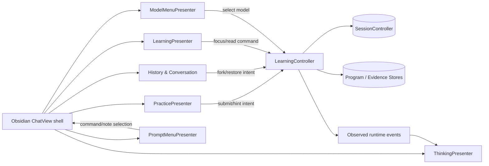

# NOX M5 — Native Desktop Acceptance & Architecture Audit

**Status: NOT RUN in native Obsidian Desktop.** Passing GitHub CI is not proof of host behavior, screenshot fidelity, interaction accessibility, or a real vault roundtrip. This document defines acceptance procedure; it is **not an attestation**.

Pull request: [#129](https://github.com/howlil/nox/pull/129). Source: `refactor/ui-feature-ownership`. Baseline: manifest version 1.3.1.
Do not merge/publish until the tested commit and native desktop evidence are independently linked and reviewed.
Never create a fake `docs/desktop-acceptance.json` or mark a case PASS from mocked DOM/unit tests.

## Graph: move → surface owner → canonical write → proof

**State authority:** UI presenters own short-lived DOM, timers, active disclosure and local pending inputs. SessionController/program/evidence repositories own durable data. App use cases perform validation, authorization, and commits. `ChatView` owns Obsidian leaf mount/unmount and dispatch. Quick response quizzes are not graded progress.

## D01–D10 — Proposed PR #129 scenario map

These ten rows define the **UI-refactor-specific** desktop acceptance run. They do not supersede any additional release policy requirements. Use a disposable vault with notes, two conversations, an active program, and one intentionally interrupted AI request.

| Case | User move / setup | Required result | Evidence |
|---|---|---|---|
| D01 — Shell | Open Nox sidebar, close it during an in-flight request, reopen it, switch vault note | No detached DOM updates, duplicate response, stale timers or console errors; old run cannot mutate new leaf | Screen recording + console capture |
| D02 — Prompt | Open `/` action menu, filter results, navigate Programs/Back, then search `@note`, Esc/Tab/Enter | Correct filtered results, no unknown command dispatch, no duplicate popup, proper keyboard selection, focus and ARIA | Recording + inspector snapshot |
| D03 — Model | Discover models; select model; simulate failed save; retry; rapidly close/reopen menu | Menu stays open on failed save, selected ID changes only on success, no stale list after dispose; Escape returns focus | Recording + state/console proof |
| D04 — History | Restore older session, fork response, select variants, archive/delete and restore | Session identity and conversation content remain correct, no stale assistant output, safe confirm deletion | Before/after transcript capture |
| D05 — Practice drafts | Type MCQ/essay/code answer, immediately navigate to new conversation, return, then retry after simulated save failure | Latest answer persists; serialization prevents old draft overwriting new; no silent loss on failed save | Before/after persisted session evidence |
| D06 — Practice evidence | Request hint, submit, cancel/retry, restore transcript | Hint/evaluation only shown after committed outcome; evidence not duplicated; Quick Quiz remains untracked | UI recording + progress read model |
| D07 — Learning | Open Map and Activity, switch filter/program, pause/resume focus, close/reopen sidebar | Program/mastery read model consistent; no double timer, no stale overlay after session switch | Recording + program data |
| D08 — Thinking | Stream phases/tool events, fail/cancel, expand/collapse, restore conversation | Only observed phases/tools shown; pending tools interrupted, done state accurate, no post-terminal remount; restored trace collapsed | Recording + console/ARIA |
| D09 — Onboarding | Begin onboarding, create/approve plan, interrupt, recover, reopen vault | Approval and workspace mutation idempotent, not duplicated; source consent preserved | Vault diff + recording |
| D10 — Visual/accessibility | Repeat menus, Thinking, Practice and Map at narrow/wide sidebar widths in Default + one community theme, with CSS snippets; keyboard & reduced motion | No overflow/blur-only popups, no clipped code editor, visible focus and controls; tokenized styles preserved | Width/theme screenshots + keyboard video |

Every case requires a native run on **the exact candidate commit**, actual Obsidian version/platform, reviewer, timestamp, and accessible GitHub-hosted evidence links. Report FAIL/BLOCKED openly rather than generating a pass record.

## Procedure and gate

1. In a disposable vault, install the build artifacts for candidate commit via a local development build, then verify the loaded `manifest.json` and bundle source match that commit.
2. Exercise all D01–D10 as described above. Record real evidence in a GitHub PR review/issue, with explicit PASS, FAIL or BLOCKED for each.
3. Rerun CI and architecture graph on the final commit after any fix. If runtime code changes, **repeat affected desktop checks**; the release verifier rejects stale tested source.
4. Once all ten are genuinely PASS, have a reviewer record `docs/desktop-acceptance.json` with exact `version`, `testedCommit` (full 40-character SHA), `platform`, `obsidianVersion`, `reviewer`, `testedAt`, and ten `cases` entries with GitHub evidence URLs.
5. Run `node scripts/verify-desktop-acceptance.mjs` and require a successful result. This is a *separate release gate* from GitHub CI; preserve Draft/hold merge while NOT RUN.

## Architecture code-review checklist

| Boundary / regression | Automated evidence | Native gate |
|---|---|---|
| No new cross-feature imports or adapter reach-through | `pnpm check:boundaries`, `pnpm architecture:graph` | N/A |
| Type safety, lint, valid CSS and bundle | CI typecheck, lint, CSS, build, artifacts | D10 |
| No parallel session, program or progress repositories | PR changed-file audit + architecture regression | D04–D07 |
| Practice draft write order, error recovery | PracticePresenter unit tests | D05–D06 |
| View close/switch invalidates stream and UI epochs | architecture guard + Thinking tests | D01, D04, D08 |
| Prompt/Model popover keyboard and late reads | presenter unit tests | D02–D03 |
| Displayed Thinking reflects only observed events | ThinkingPresenter tests | D08 |
| Onboarding and workspace idempotence | existing integration/recovery tests | D09 |

**Release decision until native proof exists: HOLD.** Do not infer that green CI constitutes Obsidian desktop acceptance.
